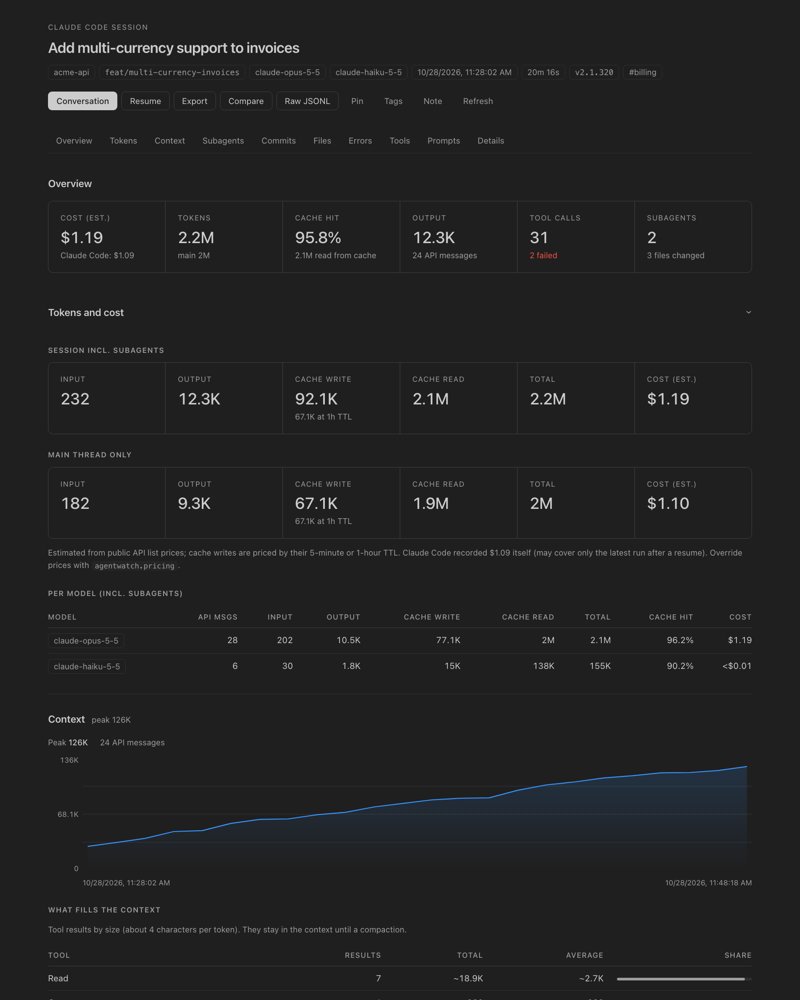
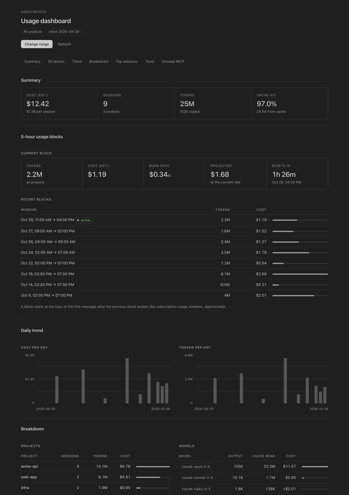
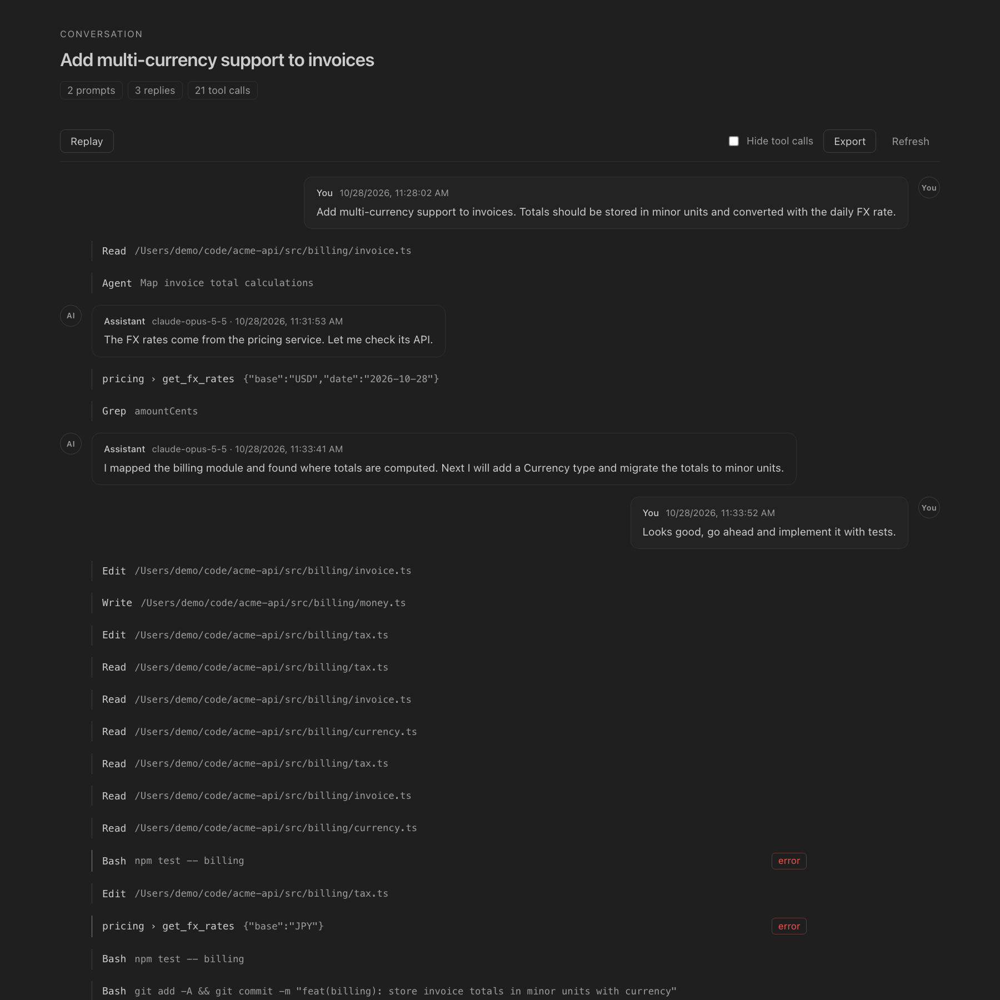
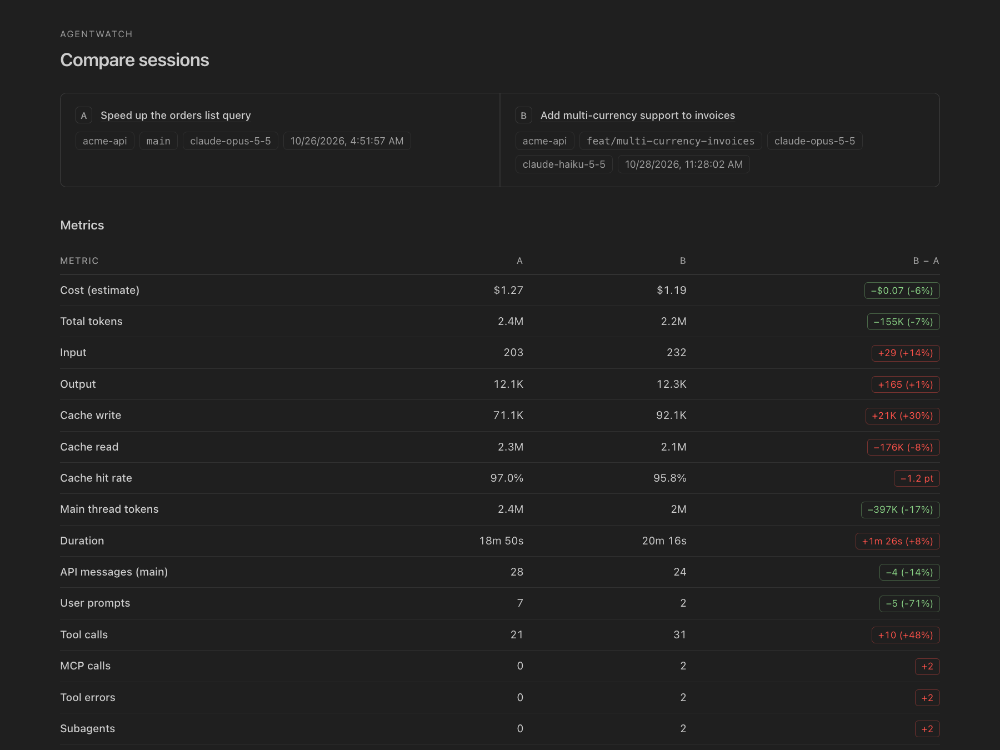

# Agent Session Watch

A VS Code extension for looking back at your Claude Code sessions. It reads the transcripts Claude Code already stores in `~/.claude/projects` and shows, for every session, what it cost, what filled its context, which subagents and MCP tools ran, which files it changed and which commits it made.

Everything is read from local files. The extension makes no network requests and sends nothing anywhere.



## Screenshots

**Usage dashboard**: cost per day, project and model, 5-hour usage blocks, most expensive sessions, and MCP servers you configured but never used.



**Conversation viewer**: the transcript as a chat, with tool calls folded and a replay mode.



**Compare sessions**: two sessions side by side, with the difference for each metric.



## Installation

Install **Agent Session Watch** from the [VS Code Marketplace](https://marketplace.visualstudio.com/items?itemName=HunhNgcCngDanh.agentwatch): search for it in the Extensions view, or run

```sh
code --install-extension HunhNgcCngDanh.agentwatch
```

Requirements: VS Code 1.85 or newer, and Claude Code having been used at least once on this machine.

To build from source instead (Node.js 18+):

```sh
git clone https://github.com/danhhuynh25029/agentwatch.git
cd agentwatch
npm install
npx @vscode/vsce package --no-dependencies   # creates agentwatch-<version>.vsix
code --install-extension agentwatch-*.vsix
```

## Quick start

1. Click the **AgentWatch** icon in the activity bar. Sessions are grouped by project, newest first.
2. Click a session to open its panel. Expand it in the tree to see subagents, MCP calls, tools, files changed and errors.
3. Use the view's toolbar to search sessions, filter them, or open the **usage dashboard**. The `…` menu has prompt search, commit lookup, session comparison and report export.
4. The status bar shows the tokens and estimated cost of the latest session in your workspace, and the current 5-hour usage block.
5. Open a file that Claude changed: a CodeLens at the top says "Edited in N Claude sessions". Click it to see the changes in a diff editor.

All commands are also in the command palette under **AgentWatch**.

## Features

### Understand a session

- **Cost and tokens**: estimated cost, input/output/cache tokens and cache hit rate, for the whole session and for the main thread, per model. The cost Claude Code recorded itself is shown next to the estimate.
- **Context**: a chart of the context size per API message with compactions marked, and a breakdown of what fills it: tool results by size, the largest results, and files read more than once.
- **Insights**: hints such as a low cache hit rate, repeated reads, huge tool results, the same error repeated, failing MCP servers, subagents running on a top-tier model, or repeated compactions.
- **Subagents**: nested subagents with their own tokens, cost, duration and status, plus a timeline of when each ran.
- **Files changed**: every file touched by `Edit` / `MultiEdit` / `Write` / `NotebookEdit`. Open the file, or see each change the session made to it in VS Code's diff editor.
- **Commits**: `git commit`s made through Bash, with hash, branch and the cost since the previous commit.
- **Errors**: every failed tool call with its input and error text.
- **Conversation viewer** with tool calls folded, a toggle to hide them, and a replay mode that steps through the session.

### Across sessions

- **Usage dashboard**: cost and tokens per day, project and model; the most expensive sessions; top subagent types, tools and MCP tools; 5-hour blocks with burn rate and projected cost; configured MCP servers that no session used. The range goes from 7 days to all time.
- **Compare** two sessions metric by metric.
- **Search** sessions by title, first prompt, project, branch, tag or note, and **filter** the tree by time range, text or pinned only.
- **Prompt library**: search every prompt you typed, then copy it, open its session, or run it in a new Claude session.
- **Find session for commit**: paste a commit hash to find the session that made it.
- **Usage report**: export Markdown, CSV (one row per session) or JSON.
- **Pins, tags and notes** per session.

### While Claude is working

- **Live mode**: the status bar shows the running tool, and open panels of a running session update as the transcript grows. Running sessions are parsed incrementally, so updates stay fast on large transcripts.
- **Notifications** when a session finishes its turn, or has been waiting on a tool call (a permission prompt or a long command) for a while. By default they only appear when VS Code is in the background.
- **5-hour blocks**: tokens used in the current 5-hour window across all projects, and the time until it resets.
- **Budgets**: optional warnings when a session or the day's total reaches a USD amount.

### Also

- **Resume** a session in a terminal (`claude --resume <id>`) and **export** it as Markdown.
- **OpenAI Codex CLI** (basic): sessions from `~/.codex/sessions` appear under "Codex" with tokens, model, tools, errors, files changed, prompts, conversation and context size.

## Cost estimates

Costs are computed from the token counts in the transcripts and first-party Claude API list prices (USD per million tokens). Cache writes are priced by their TTL as recorded in each message (5-minute: 1.25× input, 1-hour: 2× input), and cache reads at the model's cache read price.

These are estimates. They do not reflect subscription plans (Pro/Max), Bedrock or Vertex pricing, or long-context surcharges. Use the `agentwatch.pricing` setting to override prices or add models, for example Codex models, which have no built-in price. Models with no known price count as $0 and are listed under the cost cards.

## Settings

| Setting | Default | Description |
| --- | --- | --- |
| `agentwatch.projectsDir` | `~/.claude/projects` | Where Claude Code transcripts live |
| `agentwatch.autoRefresh` | `true` | Watch the directory for changes |
| `agentwatch.pricing` | `{}` | Price overrides per model id prefix, e.g. `{ "claude-opus-5-5": { "input": 4, "output": 20 } }` |
| `agentwatch.statusBar.enabled` | `true` | Show the session status bar item |
| `agentwatch.statusBar.showCost` | `true` | Show the estimated cost in the status bar |
| `agentwatch.statusBar.showBlock` | `true` | Show the current 5-hour block in the status bar |
| `agentwatch.blocks.tokenLimit` | `0` | Token budget per 5-hour block (0 = show raw tokens) |
| `agentwatch.live.enabled` | `true` | Live indicator and panel updates for running sessions |
| `agentwatch.notify.onFinish` / `onWaiting` | `true` | Notifications for running sessions |
| `agentwatch.notify.waitingSeconds` | `30` | Wait before the "waiting on a tool" notification |
| `agentwatch.notify.onlyWhenUnfocused` | `true` | Only notify when VS Code is in the background |
| `agentwatch.budget.sessionUsd` | `0` | Warn when the latest workspace session reaches this cost (0 = off) |
| `agentwatch.budget.dailyUsd` | `0` | Warn when today's total cost reaches this amount (0 = off) |
| `agentwatch.dashboard.days` | `30` | Default dashboard range in days (0 = all time) |
| `agentwatch.codeLens.enabled` | `true` | "Edited in N Claude sessions" CodeLens |
| `agentwatch.prompts.sessionLimit` | `300` | Sessions scanned by prompt search and commit lookup |
| `agentwatch.claudeCommand` | `claude` | Command used to resume a session |
| `agentwatch.claudeConfigPath` | `~/.claude.json` | Where configured MCP server names are read (names only) |
| `agentwatch.codex.enabled` | `true` | Show Codex CLI sessions |
| `agentwatch.codex.sessionsDir` | `~/.codex/sessions` | Codex rollout directory |
| `agentwatch.codexCommand` | `codex` | Command used to resume a Codex session |

## How data is read

- The session list comes from file stats. Each file's first 128 KB is read to get a provisional title and the cwd.
- A full parse runs only when you expand or open a session. It streams the file line by line, so large transcripts are never loaded into memory at once. Files over 512 MB and single lines over 16 MB are skipped.
- Results are cached by path + mtime + size. Transcripts modified in the last 10 minutes are parsed incrementally: each change reads only the appended bytes.
- The conversation viewer, export and file diffs read the transcript again on demand. Text is cut at a few thousand characters per message and 5000 entries per conversation.
- Malformed or half-written lines are skipped. Token usage is deduplicated by `message.id`, because one API message can be split across several lines.
- Subagent transcripts (`<session>/subagents/agent-<id>.jsonl`) are linked to the `Agent`/`Task` tool call that spawned them through `agent-<id>.meta.json`, or the `agentId` in the tool result.
- `~/.claude.json` and `.mcp.json` are read only for MCP server names. Commands, URLs and environment values are discarded right after parsing and never displayed or stored.

The transcript format is internal to Claude Code and not documented, so a new Claude Code version can change it. Unknown lines are ignored rather than breaking the view.

## Known limitations

- Codex support is basic: GPT models have no built-in price, and running Codex sessions are re-parsed in full on each change.
- The "waiting on a tool" notification cannot tell a permission prompt from a long-running command.
- Tested on macOS. Windows paths and shells have not been tested yet.

## Development

Requires Node.js 18+ (`node:test`).

```sh
npm install
npm run compile      # tsc -> out/
npm test             # compile + node:test on fixtures/
npm run scan         # print summaries of the 5 newest sessions
node out/scripts/scan.js -n 10 path/to/session.jsonl
```

Press **F5** in VS Code ("Run Extension") to start an Extension Development Host. The default build task runs `npm run watch`.

The screenshots in `media/screenshots/` were rendered from fictional demo transcripts, not real sessions.
